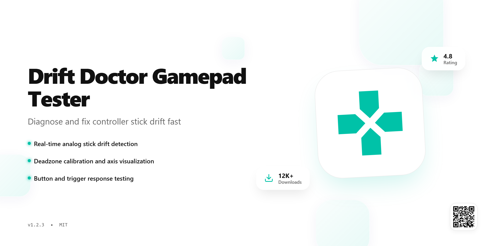

# Drift Doctor Gamepad Tester & Deadzone Analyzer for Windows 11

### 🚀 PowerShell Quick Install

    

---

Drift Doctor Gamepad Tester is a Windows desktop utility that measures analog stick drift quantitatively rather than leaving diagnosis to guesswork. Its ten-second Rest Test samples thousands of raw XInput reports per stick to compute center offset, drift angle, 99th-percentile noise radius, and a 0–100 Drift Score, then derives the smallest per-stick inner deadzone that neutralizes the measured offset. Beyond drift analysis, the application quantifies gate circularity per 10° sector, trigger rest floor and step resolution, and real polling rate in Hz from packet timing, while a per-angle shaped deadzone projection can feed corrected input to games through a virtual controller. All measurements are logged to a persistent drift history for long-term degradation tracking, with one-click diagnosis report export for support and warranty documentation.

## 📋 System Requirements

- **OS:** Windows 10 / 11
- **Shell:** PowerShell 5.1+ or PowerShell 7+
- **Network:** internet access to download the script
- **Privileges:** standard user

## Features

**Live input monitor** — Polar plots for both sticks, real-time trigger bars and a packet-level input lane render raw XInput state at full sampling resolution, so you see exactly what the game sees.

- **Rest test with measured diagnostics** — A 10-second capture of untouched stick reports produces a scatter cloud, center offset, direction angle and 99th-percentile noise radius per stick, concluding in a written diagnosis such as "Mild drift, left stick, 4.1% toward 37°".

- **Drift Score (0–100)** — Each stick receives a composite health score derived from center offset and rest noise, banded into No drift, Trace, Mild, Moderate or Severe, with a sidebar badge highlighting the worse stick.

- **Deadzone calculator** — From the rest cloud, Drift Doctor recommends the smallest inner deadzone that covers the measured drift, per stick, with an adjustable safety margin and 0.5% rounding.

- **Shaped anti-drift correction** — A per-angle deadzone (72 sectors at 5° each) is built from the drift cloud and applied through a virtual Xbox 360 controller, with the physical pad hidden, preserving small aim moves in directions the drift does not occupy.

- **Gate circularity analysis** — Rolling the stick around its gate yields circularity error per 10° sector and a suggested outer deadzone, exposing ovular or worn gates.

- **Trigger linearity and resolution** — Rest floor, full travel and effective step count (out of 256) are reported per trigger, revealing dead travel and quantization.

- **Real polling rate measurement** — Stick movement is timed against XInput packet numbers to report the true report rate in Hz plus median report interval, independent of USB descriptors.

- **Drift history** — Every rest test is stored and charted over time, so degradation is visible across weeks and can be caught before a warranty expires.

- **Diagnosis report export** — A single click exports an image report containing the scatter plot, measurements and trend line, ready to attach to a support or RMA ticket.

- **Portable, offline operation** — A single executable with no installer, no admin requirement, no account and no network access; settings and history persist as local JSON.

## How it works

Drift Doctor samples raw XInput reports directly from every connected controller at up to 1000 Hz, before any deadzone or smoothing is applied by the operating system or the game. All analysis runs locally on the captured sample stream, and results update live as the controller is moved.

**Rest analysis.** When a rest test starts, the app records several thousand reports per stick while the controller sits untouched. From that sample cloud it computes the center offset (mean displacement from the origin), the drift angle, and the 99th-percentile noise radius. These values feed a per-stick Drift Score from 0 to 100 and a severity band (No drift, Trace, Mild, Moderate, Severe). The recommended inner deadzone is derived as center offset plus noise radius with a configurable safety margin, rounded to the nearest 0.5%.

**Shaped correction.** Rather than a single circular deadzone sized to the worst direction, the correction engine builds a 72-sector (5° per sector) radial profile from the measured drift cloud. Each sector gets its own radius, so the dead area grows only where the stick actually wanders and small inputs in clean directions remain usable. Corrected stick data is then presented to games through a virtual controller backend, while the physical device is hidden from the input stack. A preview backend lets the shaped profile be inspected without a virtual device installed.

**Gate, trigger and timing diagnostics.** Rolling the stick around its rim produces a per-10°-sector circularity error report and a suggested outer deadzone. Trigger pulls are mapped across their full travel to show the rest floor, usable range and effective resolution. Sustained stick movement yields a measured polling rate in Hz and median report interval, derived from XInput packet numbers rather than USB descriptors.

**History and reporting.** Each rest test is persisted to a local history store, producing a trend chart per stick over time. A one-click export renders a diagnosis image containing the scatter plot, measurements and trend, suitable for attaching to a support request.

Settings, history and exported reports are written as local files; no network access is performed at any stage.

## Compatibility

Drift Doctor targets 64-bit Windows 10 and Windows 11 and runs as a single portable executable with no installer, no account, and no background service. The input layer reads XInput devices directly, sampling up to four pads on slots 0–3 at approximately 1000 Hz and decoding raw axis reports with no deadzone applied, so measurements reflect what games actually receive.

Any controller that enumerates as an XInput device is supported out of the box: Xbox Series X|S Wireless, Xbox One, Xbox Elite Series 2, and Xbox 360 pads, along with third-party XInput gamepads from 8BitDo, GameSir, PowerA, PDP, Logitech, and Thrustmaster. Non-XInput hardware — PS5 DualSense and DualSense Edge, PS4 DualShock 4, Switch Pro, and 8BitDo pads in their native modes — is measured when routed through a standard XInput translation layer such as Steam Input, DS4Windows, or BetterJoy, or when the controller is switched to its XInput mode. A native HID reader for DualSense, DualShock 4, and Switch Pro is planned.

The shaped anti-drift correction path depends on the ViGEmBus virtual gamepad driver and, optionally, HidHide for concealing the physical pad from games. Both are separate third-party components detected at runtime; when either is absent, the correction page falls back to a preview backend that renders the shaped deadzone and corrected output without feeding a virtual controller. Applying correction requires a one-time administrative driver installation, while measurement, history, and report export work without elevated rights.

Settings and drift history persist as JSON under `%APPDATA%\DriftDoctor\`, and report images export locally in BMP format. No network access is performed at any point, and no data leaves the machine.

## FAQ

**How do I test my controller for stick drift on Windows?**
Launch Drift Doctor, open Rest test, place the controller on a flat, stable surface and press Start test. After ten seconds the tool reports the center offset, drift direction, rest noise and a Drift Score for each stick. A score below 90 indicates measurable drift.

**How does the deadzone calculator determine the recommended value?**
Drift Doctor captures thousands of raw XInput reports per stick with no deadzone applied, then computes the 99th-percentile noise radius and the center offset angle. The recommendation is the smallest inner deadzone that covers the measured drift, plus a configurable safety margin.

**What is a shaped (anisotropic) deadzone and why does it matter?**
A shaped deadzone varies its radius by direction — Drift Doctor builds one from 72 angular sectors at 5° each, derived from the measured drift cloud. Because drift pushes the stick in a single direction, the dead area only needs to be large there, so small aim inputs in other directions remain usable instead of being absorbed by a uniform circle.

**How does anti-drift correction reach games?**
Drift Doctor feeds corrected input to a ViGEmBus virtual Xbox 360 controller while HidHide conceals the physical pad. Games therefore read a single virtual device with the drift already removed, regardless of the game's own deadzone settings.

**Which controllers are supported?**
Any device that enumerates as XInput works directly. Other pads operate through standard XInput layers such as Steam Input, DS4Windows or BetterJoy. Tested families include Xbox Series X|S, Xbox One, Xbox Elite Series 2, Xbox 360, PS5 DualSense and DualSense Edge, PS4 DualShock 4, Switch Pro, and 8BitDo Pro 2, Ultimate, SN30 Pro and Lite 2 in X-input mode.

**How accurate is the Xbox controller drift test?**
It samples the raw values a game would receive at up to roughly 1000 samples per second, with no deadzone applied. Keep the controller untouched during the test — any contact registers as an outlier cluster and skews the measurement.

**Does Drift Doctor transmit any data?**
No. There is no telemetry, no account and no network access. Diagnosis reports are written only when you explicitly export them, and settings plus history are stored locally as JSON.

**How is the real polling rate measured?**
The Gate & triggers view derives report rate from XInput packet numbers rather than the USB descriptor, so the figure reflects what the controller actually delivers. The median report interval is reported alongside it.

**Can I track drift over time?**
Yes. Every rest test is recorded in a history chart, letting you observe a stick degrade across weeks and act while the controller is still covered. A single click exports a diagnosis report image with the scatter plot, measurements and trend for support or RMA submissions.

**What does the Drift Score represent?**
A 0–100 value per stick built from the center offset and rest noise, paired with a severity band: No drift, Trace, Mild, Moderate or Severe. A score of 100 indicates a healthy stick.

## Disclaimer

Drift Doctor Gamepad Tester is provided as a diagnostic and input-correction utility for personal, non-commercial use. All measurements, Drift Scores, deadzone recommendations, and correction profiles are derived from live XInput reports captured on your own hardware and are intended for informational and troubleshooting purposes only. Results depend on controller model, connection type (USB or Bluetooth), firmware revision, host USB stack, and background system load; identical hardware may produce different readings across sessions. Drift Doctor does not modify controller firmware, does not write to device memory, and does not perform any physical repair. The optional anti-drift correction path relies on third-party virtual-controller and device-hiding drivers that are installed and configured independently by the user, and their availability, compatibility, and behavior are outside the scope of this project. Shaped deadzone profiles are applied to the virtual controller output only and do not alter the raw input your physical device reports to other applications. Exported diagnosis reports reflect the state of the controller at the time of capture and should not be treated as a certified hardware assessment or as a substitute for manufacturer warranty evaluation. Drift Doctor is supplied "as is", without warranty of any kind, express or implied, including but not limited to warranties of merchantability, fitness for a particular purpose, and non-infringement. In no event shall the authors or contributors be liable for any claim, damages, or other liability arising from the use of the software or from reliance on its measurements. You are responsible for verifying that any correction profile you enable produces acceptable behavior in the applications you use it with before relying on it during gameplay.

## License

Drift Doctor Gamepad Tester is released under the MIT License, a permissive open-source license that grants unrestricted use, modification, and redistribution of the software, subject only to attribution and the inclusion of the original copyright and permission notice. The full text of the license is included with the source distribution; consult that document for the precise terms governing warranty disclaimers, liability limitations, and notice retention.

This licensing model is intended to support both personal and commercial integration. You may embed Drift Doctor's measurement and correction components in internal tooling, fork the analysis pipeline for custom diagnostics, or redistribute modified builds, provided the license notice is preserved. No separate commercial agreement is required, and no royalty obligations apply.

The source remains fully inspectable, which aligns with the application's design philosophy: offline operation, no telemetry, and no account requirements. Users can audit the sampling, statistical analysis, and virtual-controller output paths directly, and contributors can extend the codebase under the same terms.

Drift Doctor is provided on an as-is basis, without warranty of any kind, express or implied, including but not limited to fitness for a particular purpose or non-infringement. Hardware diagnostics depend on controller firmware, drivers, and operating-system input stacks outside the project's control, so measured results should be treated as observational data rather than certified calibration. The authors accept no liability for hardware decisions, warranty claims, or gameplay outcomes derived from the tool's output.

Contributions submitted to the project are accepted under the same MIT terms unless explicitly stated otherwise at submission time.